# Evals on the Toilet

> 🧻 Evals are to models what tests are to software... well, kinda

[](evals-on-the-toilet.pdf)
[](https://github.com/open-slide/open-slide)


A talk on treating model evals the way we treat software tests: where the analogy holds, where it breaks, and which testing habits carry over.

The name is a nod to Google's [*Testing on the Toilet*](https://testing.googleblog.com/2007/01/introducing-testing-on-toilet.html) (now [*Tech on the Toilet*](https://testing.googleblog.com/2024/12/tech-on-toilet-driving-software.html)).

The deck lives in [`slides/evals-on-the-toilet/index.tsx`](slides/evals-on-the-toilet/index.tsx).

## Run it

```bash
npm install
npm run dev       # http://localhost:5173/s/evals-on-the-toilet
```

Press `F` for fullscreen and `→` / `←` to move between pages. On page 5, `→` reveals the terms of the expansion one at a time.

## Build

```bash
npm run build     # static site in dist/
npm run preview
```
